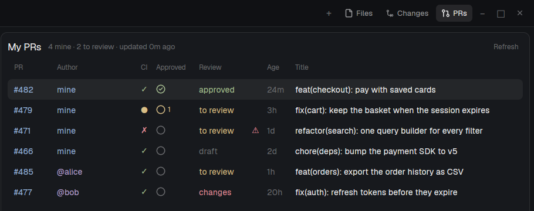
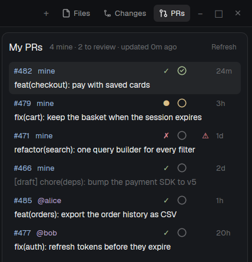
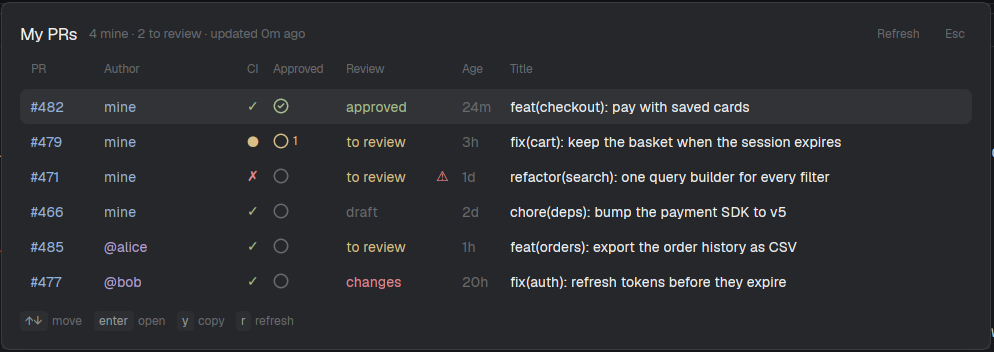

# herdr-pr-panel

Your open GitHub pull requests, and the ones waiting on your review, in the
[Herdr](https://herdr.dev) desktop app: as a side panel next to **Files** and
**Changes**, or as a popup.



*The screenshots use the built-in demo data: the PRs are made up.*

Each row shows:

| Column | Meaning |
|---|---|
| PR | the number |
| Author | `mine`, or who opened it |
| CI | ✓ passing · ✗ failing · ● running |
| Approved | green check: approved · empty circle: not yet · a number: approvals so far, not enough yet |
| Review | draft · to review · changes · approved |
| ⚠ | merge conflicts |
| Age | since the last update |
| Title | the title |

Your own PRs come first, newest first. The list refreshes every 2 minutes.

| Key | Does |
|---|---|
| `↑` `↓` or `j` `k` | move |
| `enter` or click | open the PR in your browser |
| `y` | copy its link |
| `r` | refresh now |
| `esc` | close (popup) |

In a narrow panel the rows fold onto two lines:



## Requirements

- The **Herdr desktop app** (`herdr-app`, tested with 0.1.15). This is an app
  mod, not a plugin for the `herdr` terminal UI.
- The **[GitHub CLI](https://cli.github.com)**, signed in: `gh auth login`.
- macOS or Linux.

## Install

The folder must be named `my-prs`: the mod loads its icons from
`mods/my-prs/`.

```sh
git clone https://github.com/constant-gayet/herdr-pr-panel ~/.config/herdr-app/mods/my-prs
herdr-app check ~/.config/herdr-app/mods/my-prs
```

The app picks it up straight away.

### As a popup

Add a key to `~/.config/herdr-app/keys.json`:

```json
{ "global": { "ctrl-shift-g": "mod.open:my-prs" } }
```

The key opens the popup and closes it again; so does `esc`.



### As a side panel next to Files and Changes

The side panel is a stack in your layout (`panel-body`), and the **Files** /
**Changes** buttons belong to Herdr's `tabs` mod. You need a personal layout
and your own copy of `tabs`.

1. **A personal layout.** If you're still on the shipped `main` layout, clone
   it: `herdr-app do layout.clone --name main` (it switches to `main-copy`).
2. **Add the panel** to that layout's `panel-body` stack, next to `files`
   and `changes`:

   ```json
   { "id": "prs", "type": "block", "content": { "mod": "my-prs" } }
   ```

3. **Add the button.** Copy the tab bar: `herdr-app do mod.clone --name tabs
   --as tabs-prs`, then in `mods/tabs-prs/main.js`:

   ```js
   // 1. import nextCommand from "herdr" along with the rest.

   // 2. In init(_props, cx), listen for the toggle command:
   cx.spawn(async (cx) => {
     for (;;) {
       if ((await nextCommand()) === "toggle-prs") this.togglePanel("prs");
       cx.notify();
     }
   });

   // 3. A method on the class:
   togglePanel(id) {
     const root = layout(), panel = find(root, "panel"), body = find(root, "panel-body");
     if (panel && !panel.hidden && body?.active === id) run("layout.hide", { id: "panel" });
     else { run("layout.select", { stack: "panel-body", child: id }); run("layout.show", { id: "panel" }); }
   }

   // 4. In render(), keep "prs" when switching spaces:
   const enabled = [...(shared("workspace.panels") ?? ["files", "changes"]), "prs"];

   // 5. And the button, after the Changes one:
   .child(panelButton("prs", "PRs", "mods/my-prs/pr.svg"))
   ```

   In your layout, point the `tabs` block at the copy:
   `"content": { "mod": "tabs-prs" }`.

4. **A key** (optional), in `keys.json`:

   ```json
   { "global": { "ctrl-shift-g": "tabs-prs.toggle-prs" } }
   ```

The copy of `tabs` no longer gets Herdr's updates to the tab bar. To undo,
point the layout back at `tabs`, or press `ctrl-alt-shift-escape` to reset
the layout.

## Configuration

Optional, in `~/.config/herdr-app/my-prs.json` (see
[`config.example.json`](config.example.json)):

| Key | Default | What it does |
|---|---|---|
| `query` | `is:pr is:open archived:false (author:@me OR review-requested:@me)` | any GitHub search, including `AND` / `OR` and parentheses |
| `me` | your `gh` login | which author counts as `mine` |
| `refresh_seconds` | `120` | how often it refreshes (at least 30) |
| `demo` | `false` | show made-up PRs instead of yours |

For example, only one repo, and only reviews requested from you directly,
not from one of your teams:

```json
{
  "query": "repo:acme/shop is:pr state:open AND (author:@me OR (review-requested:@me AND -team-review-requested:acme/backend))"
}
```

Changes apply at the next refresh (`r`).

## How it works

The mod runs `gh api graphql` with your search query, as
[`ISSUE_ADVANCED`](https://docs.github.com/en/graphql/reference/enums#searchtype)
search, and draws the result. It has no token or sign-in of its own: `gh`
uses the one it already has, so the panel sees exactly what you can see on
github.com. If your organisation requires SAML SSO, that `gh` token needs to
be authorised for it, as it would for any other `gh` command.

Links open with `xdg-open` (Linux) or `open` (macOS). Copying uses `pbcopy`,
`wl-copy`, `xclip` or `xsel`, whichever is there.

## Credits

The icons come from [Lucide](https://lucide.dev) (ISC license).

## License

MIT
